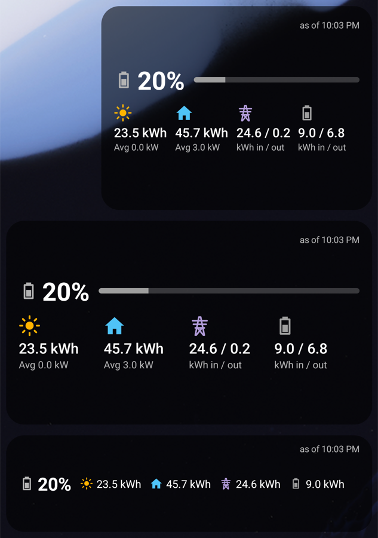
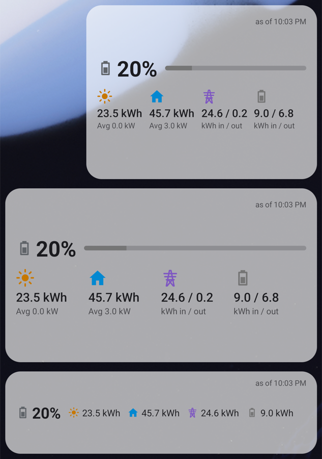

# FranklinWH Android Widget

An Android home-screen widget that shows FranklinWH home-battery stats (state of
charge, solar, load, grid and battery power, daily energy totals). It reads them
from one of two sources, picked on the configuration screen:

- **Local** (the default): polls the aGate gateway directly over your local
  network. No cloud account, no MQTT, no credentials: the only configuration
  is the gateway's host and port. Works only on the home network.
- **Cloud**: reads the same values through FranklinWH's app cloud API, so it
  also works away from home. Needs your FranklinWH app account and the
  gateway's serial number. This API is **unofficial and undocumented**: it is
  the one the FranklinWH app uses, not a published partner API, and FranklinWH
  may change or block it at any time, which would break this source.

There is no automatic fallback between the two.

This is an unofficial project. It is not affiliated with, endorsed by, or
supported by FranklinWH.

## Screenshots

The three widgets (dashboard, summary and strip, top to bottom) showing the
daily view, in dark and light mode:

<p>
  
  
</p>

## Status

Alpha. It is in daily use on one phone with one aGate, and has also run on an
Android 16 emulator. Nothing else has been tested: other gateway hardware or
firmware, other phones and launchers, and accounts that need multi-factor
sign-in may not work. Reports are welcome in the
[issue tracker](https://github.com/martinb3/franklinwh-android-widget/issues).

## Install

Sideload only. It is not on Google Play or F-Droid.

1. On the phone, download the `.apk` from the
   [latest release](https://github.com/martinb3/franklinwh-android-widget/releases/latest).
2. Open the downloaded file. Android asks you to allow your browser or file
   manager to install unknown apps; allow it, then install.
3. Follow [Setup](#setup).

Minimum Android version is 8.0 (API 26). Each release lists the APK's SHA-256
so the download can be checked. Updates are manual: install a newer APK over
the old one, and settings and placed widgets are kept.

To build it yourself instead, with JDK 17 or newer and the Android SDK
(`ANDROID_HOME` set, or a `local.properties` with `sdk.dir`):

```sh
./gradlew assembleDebug
adb install -r app/build/outputs/apk/debug/app-debug.apk
```

An APK you build yourself is signed with a different key from the released
one, so neither can be installed over the other; uninstall first.

## Setup

1. Add one of the widgets (Battery strip, Energy summary or Energy
   dashboard) to a home screen, then open the configuration screen. On
   Android 12 and later the widget is placed straight away and shows "Tap to
   set up"; tap it. On older versions the screen opens on its own. It is also
   reachable from the "FranklinWH Widget" app icon.
2. Pick **Local (LAN)** or **Cloud**.
   - Local: enter the gateway's IP address or hostname on your LAN and its
     TCP port (default 9000).
   - Cloud: enter your FranklinWH app account email and password, and the
     gateway serial number. The serial is in the FranklinWH app under
     **More → Site Address → SN**. Accounts that need multi-factor sign-in
     are not supported.

   Then press **Test connection**. On success it shows the battery level and
   solar power it read.
3. Press **Save**. The widget fetches a reading immediately.

- Optional: **Solar capacity (kW)** and **Grid limit (kW)**. When set, the
  live view on larger widget sizes shows solar output and grid flow as bars
  scaled to these values (for example, a 200 A service at 240 V is 48 kW).
  Leave them blank for no bars.

The same screen is reachable from the app's launcher icon and from the
launcher's "reconfigure" action on the widget.

## What Local mode needs

- Only the phone and the gateway. There is no MQTT broker, Home Assistant
  instance, bridge or server of your own to run.
- A network path from the phone to the gateway's TCP port 9000. Normally that
  means the phone is on the home Wi-Fi. If the gateway sits on a separate
  VLAN or IoT network, the firewall has to let the phone reach it.
- A gateway address that does not change. Give the aGate a DHCP reservation
  on your router, or the configured address stops working when it moves.

Local mode has been tested against a single aGate. It is not known whether
every aGate model and firmware version answers on port 9000. If **Test
connection** fails with the right address, use Cloud mode, and please open an
issue saying which gateway you have.

## What the widget shows

The widget has two views and picks one by the age of its data:

- **Live view**, when the reading is under two minutes old: battery
  percentage and instantaneous power for solar, load, grid and battery.
  A "+" on grid or battery means that source is supplying the house.
- **Daily view**, otherwise: battery percentage and today's energy totals.
  Solar and load show kWh, with "Avg 1.8 kW" below once the widget has
  readings at least 15 minutes apart (derived from the gateway's energy
  counters). Grid and battery show "in / out" pairs such as "24.6 / 0.2"
  (kWh imported / exported, charged / discharged). Each tile's icon names
  the reading.

Every view carries the data's age ("just now" for the first two minutes, then
"as of 14:05", "as of Mon 14:05" or "as of 3 Oct 14:05") so a stale number is
never mistaken for a current one.

There are three widgets in the picker, sharing one setup and one set of data:

- **Battery strip**: 1 row tall, 2 to 5 cells wide (default 4×1). Battery
  percentage and readings in a single line; at 2 cells only solar and load.
- **Energy summary**: 2 rows tall, 2 to 5 cells wide (default 4×2). Battery
  percentage and charge bar over tiles; at 2 cells only solar and load.
- **Energy dashboard**: 3 rows and up, 2 to 5 cells wide (default 3×3).
  Larger type, tiles in a 2×2 grid, and the optional capacity bars.

After the first setup, more widgets are added without the setup screen on
Android 12 and later.

Display rules follow the same conventions as the pixel-clock bridge this was
modelled on: power is always kW with one decimal; anything under 100 W reads
as an unsigned `0.0 kW`; grid and battery are signed, `+` when supplying the
house (grid importing, battery discharging) and `−` when absorbing (grid
exporting, battery charging); solar and load are unsigned.

## How it refreshes, and why

The widget is built to be gentle on the phone's battery:

- **Tap the widget** to fetch a fresh reading. This is the primary way to get
  live numbers and takes about a second on the LAN.
- **A background job runs every 30 minutes**. In Local mode it runs only on
  an unmetered (Wi-Fi) network, since the gateway is only reachable on the
  LAN anyway; in Cloud mode it runs on any connected network. Android may
  defer it further when the phone is idle.
- A failed fetch keeps the last good reading and shows the error on the
  widget; the age text keeps counting.

Every fetch, including the one a tap starts, runs in the background. Android
blocks background traffic on metered networks (mobile data, and Wi-Fi that
Android treats as metered, such as some in-flight or hotspot networks) for an
app whose background data is switched off. In Cloud mode the widget then
keeps showing its last reading and never updates. If that happens, open
**Settings → Apps → FranklinWH Widget → Mobile data & Wi-Fi** and turn on
**Background data**. If Data Saver is on, also turn on **Unrestricted mobile
data usage**. Local mode is unaffected, since it only uses unmetered Wi-Fi.

There is deliberately no always-on connection and no persistent notification.
A "live while the screen is on" mode that polls every 30 seconds is planned
as an opt-in.

## Security note

The gateway's local protocol has no authentication. Anyone on your LAN who can
reach the gateway's TCP port 9000 can read its data, including its serial number.
This app does not change that; it only reads what the gateway already exposes.
Consider isolating the gateway on a network segment you trust.

In Local mode the app never needs the serial: it sends a placeholder and
recovers the protocol's obfuscation key from the reply.

In Cloud mode the app stores the account email and gateway serial, plus the
MD5 hash of your password and the latest login token, never the password
itself. The hash and token are encrypted with a key held in the Android
Keystore, and app backup is off. The MD5 hash is enough to sign in to your
FranklinWH account, so treat a compromised phone as a compromised account.

## Development

```sh
./gradlew assembleDebug testDebugUnitTest
```

The protocol tests compare against frames generated by the reference Python
library with fake serials (`app/src/test/resources/golden.json`); regenerate
with `tools/gen_golden.py`. An opt-in test talks to a real gateway when
`FWH_HOST` is set:

```sh
FWH_HOST=192.0.2.10 ./gradlew :app:testDebugUnitTest --tests '*GatewayLiveTest*' --rerun
```

Keep real hostnames, IP addresses and serial numbers out of the repository.

`./gradlew assembleRelease` signs the APK when a `keystore.properties` file
exists in the project root, or at the path in `FWH_KEYSTORE_PROPERTIES`. It
holds `storeFile`, `storePassword`, `keyAlias` and `keyPassword`; a relative
`storeFile` is resolved against the properties file's directory. Without the
file the release APK is left unsigned.

## Attribution

The local protocol implementation is a Kotlin port of
[franklinwh-local](https://pypi.org/project/franklinwh-local/) (MIT License),
which in turn builds on the original protocol work by voidstarr. The cloud
source follows the endpoints used by the
[franklinwh](https://github.com/richo/franklinwh-python) Python library (MIT
License).

## License

BSD-3-Clause. See [LICENSE](LICENSE).
